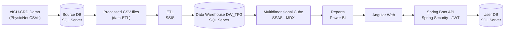

# Clinical Data Warehouse for ICU Admissions

> Final Degree Project · Computer Science Engineering (Information Systems) · University of Málaga

[](README.md)

Implementation of a data warehouse from an ICU hospitalization data set, with its ETL process, a multidimensional cube, reports in Power BI and a web application with role-based access.

## Summary

The aim is to create a clinical data warehouse based on the [eICU Collaborative Research Database (demo version)](https://physionet.org/content/eicu-crd-demo/2.0.1/) [[1]](#references-1) [[2]](#references-2) [[3]](#references-3), a collaborative research database containing data on ICU admissions from hospitals across the United States between 2014 and 2015, and to design a website that allows users to access, visualise and interact with the data in the data warehouse.

What the project includes:

- **Modelling:** analysis of the data source, conceptual and logical design of a data warehouse with **three fact tables** that share dimensions.
- **ETL:** loading the data warehouse using SQL Server Integration Services (SSIS).
- **Multidimensional cube:** SQL Server Analysis Services (SSAS), queryable using MDX.
- **Reports:** two sample reports in Power BI, one per role, integrated into the website.
- **Web application:** front-end in Angular and back-end in Spring Boot, with JWT authentication and role-based access control.

## System Architecture



| Layer | Technology |
|---|---|
| Source Data | eICU-CRD Demo 2.0.1 (CSV) |
| Database and Warehouse | SQL Server |
| Model | Oracle SQL Developer Data Modeler |
| ETL | SSIS (Visual Studio 2019 + SQL Server Data Tools) |
| Cube | SSAS multidimensional, MDX queries |
| Reports | Power BI |
| Backend | Java 17, Spring Boot 3, Spring Data JPA, Spring Security, JWT |
| Frontend | Angular |

## Solution
<div align="right">
  <br>
  <sub>Login screen</sub>
</div>

<br>

<div align="right">
    <br>
    <sub>Manager’s screen after logging in</sub>
</div>

<br>

<div align="right">
  <br>
  <sub>Head of the Cardiovascular Department’s screen</sub>
</div>

## Repository Structure

```
├── docs/          conceptual and relational models and web screenshots
├── database/      SQL scripts for the source database and the data warehouse
├── data-ETL/      processed CSV files used by the ETL
├── ETL_TFG/       SSIS project
├── Cubo_TFG/      SSAS project
├── Backend_TFG/   Spring Boot API
└── Frontend_TFG/  Angular web
```

## Data Warehouse Design

After analysing the available data and testing various conceptual designs, we opted for a database with three facts (`AdmittedToICU`, `VitalMeasures` and `NonInvasiveBloodPressure`), all of which are related to the `Time` hierarchy and to `PatientUnitStay`. The diagrams are in the [`docs`](/docs) folder.

### Conceptual Model

The diagram shows how the facts (cubes) relate to the dimensions (tables), their hierarchies and the content of each table. The colours indicate which table in the source database each value comes from.


- **Cardinalities.** Typically, there is a 1:n relationship between a dimension and a fact, but due to the way the source database was structured, some dimensions have an m:n relationship with the fact. Furthermore, `AdmittedToICU` and `PatientUnitStay` have a 1:1 relationship, because each patient had a single row in the tables that feed into that fact.
- **`Time` dimension.** For privacy reasons, the database does not include the day or month: only the time of admission and discharge, the year of discharge and the discharge *offset* (minutes since admission). Therefore, `Time` stores the time, the number of days since admission and the year, calculated during the ETL process.
- **Hierarchies of `Diagnosis`, `Treatment`, `PhysicalExam` and `PastHistory`.** The type/service, subtype, value and additional information were contained in a single column separated by `/` or `|`, and these had to be split during the ETL process.
- **`Lab` dimension.** This combines the `Lab` and `CustomLab` tables.
- **`AdmissionDiagnosis` hierarchy.** The `Service` level was required for grouping. The relationship between each admission diagnosis and its service was obtained by feeding Copilot the `Diagnosis` services and the `AdmissionDiagnosis` values, while manually checking that the result was correct.

### Relational Model

The logical model is based on the conceptual model and defines, for each table, the primary and foreign keys, the data type of each attribute (`INTEGER`, `VARCHAR`, etc.) and whether it allows null values.


Diagram notation: `P*` primary key, `F*` foreign key, `PF*` key that is both primary and foreign.

- **1:n relationship:** the foreign key is in the ‘many’ side table. For example, `AdmittedToICU` stores `Unit_UnitID`, because a unit may appear in many admissions.
- **M:n relationship:** an intermediate table is used, whose primary key is the combination of the two foreign keys. For example, `Allergy_AdmFact` (`Allergy_AllergyID` + `AdmittedToICU_AdmICUID`) links allergies to admissions.

The table creation script (DDL) was generated using Oracle SQL Developer Data Modeller and adapted for Microsoft SQL Server.

## How to replicate the project

### Requirements

- SQL Server and SQL Server Management Studio.
- Microsoft Visual Studio Community 2019 with SQL Server Data Tools and the Integration Services and Analysis Services projects extensions.
- Java 17 and an IDE for the backend.
- Node.js and Angular CLI for the frontend.

Execution order: [1. Source DB](#1-source-database) → [2. Data Warehouse](#2-data-warehouse) → [3. CSV](#3-csv-files-used-by-the-etl) → [4. ETL](#4-etl-process) → [5. Cube](#5-multidimensional-cube) → [6. Web](#6-web-app).

> It is advisable not to change the names of the database and the data warehouse, to avoid incompatibilities with the following steps.

### 1. Source Database

- The data is sourced from the [eICU Collaborative Research Database Demo](https://physionet.org/content/eicu-crd-demo/2.0.1/): open access, licensed under ODbL 1.0 and de-identified in accordance with the HIPAA safe harbour provision.
- The SQL scripts for [creating the tables](/database/create-DB.sql) and [adding foreign keys](/database/add-fk-DB.sql) come from the code repository linked on the PhysioNet website, and have been adapted from PostgreSQL to SQL Server.
- The data is loaded using the [`script-load-DB`](/database/script-load-DB.ipynb) notebook, which generates the load file.

To replicate it:
1. Download the CSV files from the official website.
2. Create a new database in SQL Server called `eICU Collaborative Research Database`.
3. Run the creation and foreign key scripts in the database.
4. In the notebook, change the path pointing to the CSV files and run it to load the data.

### 2. Data Warehouse

1. Create a new database called `DW_TFG`.
2. Run [`create-DW`](/database/create-DW.sql) script in it.

### 3. CSV Files Used by the ETL

For the ETL process, some inconsistencies in the database data had to be corrected manually. Two examples:

- **`Patient` table:** some patients had multiple genders or ethnicities recorded. In the source database, this information is stored for each `PatientUnitStay` (each ICU admission), and sometimes a different value or a null value was assigned. A CSV file was created with a single value per patient, with cases involving multiple options resolved manually.
- **`Diagnosis`, `Treatment`, `PhysicalExam` and `PastHistory` tables:** the type/service, subtype, value and additional information were all contained in a single column separated by `/` or `|`, and these were split into separate columns.

The resulting files are in [`data-ETL`](/data-ETL).

### 4. ETL Process

1. Download the [`ETL_TFG`](/ETL_TFG) folder and open the `ETL_TFG.sln` solution in Visual Studio.
2. Double-click on `Project.params` (in the right-hand menu) and change the `DataFolder` parameter to the folder containing the CSV files from the previous section.
3. Run the project by clicking *Start*.

### 5. Multidimensional Cube
1. Download the [`Cubo_TFG`](/Cubo_TFG) folder and open the `Cubo_TFG.sln` solution in Visual Studio.
2. Change the data source to the database you have created: double-click on `DW_TFG.ds` → *Edit…* and configure:
   - *Server name*: a full stop (`.`).
   - *Authentication*: SQL Server (using your credentials).
   - *Select or enter a database name*: the data warehouse.
3. Run the project by clicking *Start*.

### 6. Web App

**User database.** Create a new database in SQL Server and run the [`create-users-DB`](/database/create-users-DB.sql) script. This script creates a single `user` table with the columns `id`, `firstname`, `lastname`, `password`, `role` and `username`. It also adds three users for the website demonstration:

| Username | Password | Role | Acceso |
|---|---|---|---|
| `administrador` | demo-admin-2026 | `ADMIN` | Can register new users (only via a direct call to the API) |
| `gerente` | demo-gerente-2026 | `GERENTE` | Report containing all the warehouse data |
| `jefe` | demo-jefe-2026 | `JEFE_CARDIOVASCULAR` | Report containing only the details of their service (Cardiovascular) |

> *Gerente* refers to the Hospital manager \
> *Jefe Cardiovascular* refers to Head of the Cardiovascular Department

Passwords are stored as BCrypt hashes, the format expected by Spring Security’s BCryptPasswordEncoder.

**Backend.**

1. Download the [`Backend_TFG`](/Backend_TFG) folder and add a `.env` file containing the following variables:

   ```
   DB_NAME=name_of_the_user_database
   DB_USER=your_SQL_Server_username
   DB_PASS=your_SQL_Server_password
   JWT_SECRET=secret_key_in_base64
   ```

   `JWT_SECRET` is the secret used to sign the tokens: a random string of at least 256 bits encoded in Base64. The `.env` file is listed in `.gitignore`.

   The backend uses the `springboot3-dotenv` dependency, which loads the `.env` file on start-up. It must be located in the root directory of `Backend_TFG`.

2. Open a terminal in the root folder and run:

```
mvn compile
mvn spring-boot:run
```

The API has two operations: **login**, which verifies the username and password and returns a JWT with the role; and **user registration**, which only accepts `ADMIN` tokens. The token is used for this second operation, and neither the frontend nor any other client can register users without it.

**Frontend.** Download the [`Frontend_TFG`](/Frontend_TFG) folder, open a terminal in it and run:

```
npm install
ng serve -o
```

It will open at `http://localhost:4200`.

## Decisions and limitations

- The data is from the eICU demo version, a subset of the full database.
- The CSV files in `data-ETL` include manual corrections.
- The relationship between admission diagnoses and services was generated with the help of Copilot (see [conceptual model](#conceptual-model)).

## Licences

- **Code** (`ETL_TFG`, `Cubo_TFG`, `Backend_TFG`, `Frontend_TFG` and my scripts): MIT licence, see [`LICENSE`](LICENSE).
- **Derived data** (`data-ETL`): [Open Data Commons Open Database License v1.0 (ODbL)](https://opendatacommons.org/licenses/odbl/1-0/), see [`LICENSE`](/data-ETL/LICENSE.txt), the same as that of the original data. If the data is redistributed or adapted, the source must be cited and that licence must be retained.
- **Scripts for creating the source database:** adapted from the eICU code repository; please refer to the licence there.

## References

* <a name="references-1">[1]</a> Johnson, A., Pollard, T., Badawi, O., & Raffa, J. (2021). eICU Collaborative Research Database Demo (version 2.0.1). PhysioNet. RRID:SCR_007345. https://doi.org/10.13026/4mxk-na84
* <a name="references-2">[2]</a> Pollard, T., Moody, B. E., Lehman, L., Gow, B., Fernandes, C., Xie, C., Johnson, A., Mark, R. G., & Heldt, T. (2026). PhysioNet as a global platform for biomedical research. Nature Health. https://doi.org/10.1038/s44360-026-00096-z. Available from: https://rdcu.be/faatM
* <a name="references-3">[3]</a> Pollard, T. J., Johnson, A. E. W., Raffa, J. D., Celi, L. A., Mark, R. G., & Badawi, O. (2018). The eICU Collaborative Research Database, a freely available multi-center database for critical care research. Scientific Data, 5, 180178. https://doi.org/10.1038/sdata.2018.178