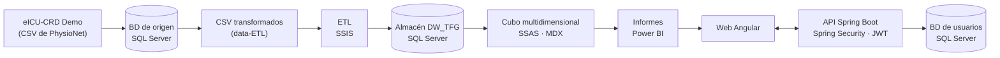

# Almacén de datos clínico para ingresos en UCI

> Trabajo de Fin de Grado · Ingeniería Informática (Sistemas de Información) · Universidad de Málaga

[](README.en.md)

Implementación de un *datawarehouse* a partir de un conjunto de datos de hospitalización en UCIs, con su proceso ETL, un cubo multidimensional, informes en Power BI y una aplicación web con acceso por roles.

## Resumen

El objetivo es crear un almacén de datos clínico a partir de la [eICU Collaborative Research Database (versión demo)](https://physionet.org/content/eicu-crd-demo/2.0.1/) [[1]](#referencias-1) [[2]](#referencias-2) [[3]](#referencias-3), una base de datos de investigación colaborativa con ingresos en UCI de hospitales de todo Estados Unidos entre 2014 y 2015, y diseñar una web que permita acceder a los datos del almacén, visualizarlos e interactuar con ellos.

Lo que incluye el proyecto:

- **Modelado:** estudio de la fuente, diseño conceptual y lógico de un almacén con **tres tablas de hechos** que comparten dimensiones.
- **ETL:** carga del almacén con SQL Server Integration Services (SSIS).
- **Cubo multidimensional:** SQL Server Analysis Services (SSAS), consultable con MDX.
- **Informes:** dos informes de ejemplo en Power BI, uno por rol, integrados en la web.
- **Aplicación web:** frontend en Angular y backend en Spring Boot, con autenticación JWT y control de acceso por roles.

## Arquitectura



| Capa | Tecnología |
|---|---|
| Datos de origen | eICU-CRD Demo 2.0.1 (CSV) |
| Base de datos y almacén | SQL Server |
| Modelado | Oracle SQL Developer Data Modeler |
| ETL | SSIS (Visual Studio 2019 + SQL Server Data Tools) |
| Cubo | SSAS multidimensional, consultas MDX |
| Informes | Power BI |
| Backend | Java 17, Spring Boot 3, Spring Data JPA, Spring Security, JWT |
| Frontend | Angular |

## Resultado
<div align="right">
  <br>
  <sub>Pantalla de inicio de sesión</sub>
</div>

<br>

<div align="right">
    <br>
    <sub>Pantalla del Gerente después de iniciar sesión</sub>
</div>

<br>

<div align="right">
  <br>
  <sub>Pantalla del Jefe del servicio Cardiovascular</sub>
</div>

## Estructura del repositorio

```
├── docs/          diagramas conceptual y relacional y capturas web
├── database/      scripts SQL de la BD de origen y del almacén
├── data-ETL/      CSV transformados que consume el ETL
├── ETL_TFG/       proyecto SSIS
├── Cubo_TFG/      proyecto SSAS
├── Backend_TFG/   API Spring Boot
└── Frontend_TFG/  aplicación Angular
```

## Diseño del almacén

Tras analizar los datos disponibles y probar varios diseños conceptuales, se optó por un almacén con tres hechos (`AdmittedToICU`, `VitalMeasures` y `NonInvasiveBloodPressure`) relacionados todos ellos con la jerarquía `Time` y con `PatientUnitStay`. Los diagramas están en la carpeta [`docs`](/docs).

### Modelo conceptual

El diagrama muestra cómo se relacionan los hechos (cubos) con las dimensiones (tablas), sus jerarquías y el contenido de cada tabla. Los colores indican de qué tabla de la base de datos original procede cada valor.


- **Cardinalidades.** Lo habitual es una relación 1:n entre dimensión y hecho, pero por cómo estaba construida la base de datos original, algunas dimensiones se relacionan con el hecho en m:n. Además, `AdmittedToICU` y `PatientUnitStay` están en 1:1, porque cada paciente tenía una única fila en las tablas que alimentan ese hecho.
- **Dimensión `Time`.** Por privacidad, la base de datos no incluye día ni mes: solo la hora de ingreso y alta, el año del alta y el *offset* del alta (minutos desde el ingreso). Por eso `Time` almacena la hora, el número de días desde el ingreso y el año, calculados en el ETL.
- **Jerarquías de `Diagnosis`, `Treatment`, `PhysicalExam` y `PastHistory`.** El tipo/servicio, el subtipo, el valor y la información adicional venían en una sola columna separada por `/` o `|`, y hubo que dividirlas en el ETL.
- **Dimensión `Lab`.** Combina las tablas `Lab` y `CustomLab`.
- **Jerarquía de `AdmissionDiagnosis`.** Para poder agrupar se necesitaba el nivel `Service`. La relación entre cada diagnóstico de ingreso y su servicio se obtuvo dando a Copilot los servicios de `Diagnosis` y los valores de `AdmissionDiagnosis`, revisando a mano que el resultado fuese correcto.

### Modelo relacional

El modelo lógico parte del conceptual y define, para cada tabla, las claves primarias y foráneas, el tipo de cada atributo (`INTEGER`, `VARCHAR`, etc.) y si admite nulos.


Notación del diagrama: `P*` clave primaria, `F*` clave foránea, `PF*` clave que es primaria y foránea a la vez.

- **Relación 1:n:** la clave foránea va en la tabla del lado "muchos". Por ejemplo, `AdmittedToICU` guarda `Unit_UnitID`, porque una unidad puede aparecer en muchos ingresos.
- **Relación m:n:** se usa una tabla intermedia cuya clave primaria es la combinación de las dos claves foráneas. Por ejemplo, `Allergy_AdmFact` (`Allergy_AllergyID` + `AdmittedToICU_AdmICUID`) relaciona alergias con ingresos.

El script de creación de tablas (DDL) se generó con Oracle SQL Developer Data Modeler y se adaptó a Microsoft SQL Server.

## Cómo replicar el proyecto

### Requisitos

- SQL Server y SQL Server Management Studio.
- Microsoft Visual Studio Community 2019 con SQL Server Data Tools y las extensiones de proyectos de Integration Services y de Analysis Services.
- Java 17 y un IDE para el backend.
- Node.js y Angular CLI para el frontend.

Orden de ejecución: [1. BD de origen](#1-base-de-datos-de-origen) → [2. Almacén](#2-almacén-de-datos) → [3. CSV](#3-ficheros-csv-para-el-etl) → [4. ETL](#4-procesos-etl) → [5. Cubo](#5-cubo-multidimensional) → [6. Web](#6-aplicación-web).

> Es recomendable no cambiar los nombres de la base de datos y del almacén, para evitar incompatibilidades con los pasos siguientes.

### 1. Base de datos de origen

- Los datos proceden de [eICU Collaborative Research Database Demo](https://physionet.org/content/eicu-crd-demo/2.0.1/): acceso abierto, bajo licencia ODbL 1.0 y desidentificados según la disposición *safe harbor* de HIPAA.
- Los scripts SQL para [crear las tablas](/database/create-DB.sql) y [añadir las claves foráneas](/database/add-fk-DB.sql) proceden del repositorio de código que enlaza la web de PhysioNet, y se han adaptado de PostgreSQL a SQL Server.
- Los datos se cargan con el cuaderno [`script-load-DB`](/database/script-load-DB.ipynb), que genera el fichero de carga.

Para replicarlo:

1. Descargar los CSV de la web oficial.
2. Crear una base de datos nueva en SQL Server llamada `eICU Collaborative Research Database`.
3. Ejecutar en ella los scripts de creación y de claves foráneas.
4. En el cuaderno, cambiar la ruta que apunta a los CSV y ejecutarlo para cargar los datos.

### 2. Almacén de datos

1. Crear una base de datos nueva llamada `DW_TFG`.
2. Ejecutar en ella el script [`create-DW`](/database/create-DW.sql).

### 3. Ficheros CSV para el ETL

Para el ETL hubo que corregir a mano algunas inconsistencias de los datos de la base de datos. Dos ejemplos:

- **Tabla `Patient`:** algunos pacientes tenían varios géneros o etnias registrados. En la base de datos original esta información se guarda por cada `PatientUnitStay` (cada ingreso en UCI), y a veces se asignaba un valor distinto o nulo. Se creó un CSV con un único valor por paciente, resolviendo a mano los casos con varias opciones.
- **Tablas `Diagnosis`, `Treatment`, `PhysicalExam` y `PastHistory`:** el tipo/servicio, el subtipo, el valor y la información adicional venían en una única columna separada por `/` o por `|`, y se dividieron en columnas.

Los ficheros resultantes están en [`data-ETL`](/data-ETL).

### 4. Procesos ETL

1. Descargar la carpeta [`ETL_TFG`](/ETL_TFG) y abrir la solución `ETL_TFG.sln` con Visual Studio.
2. Hacer doble clic en `Project.params` (menú de la derecha) y cambiar el parámetro `DataFolder` por la carpeta con los CSV del apartado anterior.
3. Ejecutar el proyecto con *Iniciar*.

### 5. Cubo multidimensional

1. Descargar la carpeta [`Cubo_TFG`](/Cubo_TFG) y abrir la solución `Cubo_TFG.sln` con Visual Studio.
2. Cambiar el origen de datos al almacén creado: doble clic en `DW_TFG.ds` → *Edit…* y configurar:
   - *Server name*: un punto (`.`).
   - *Authentication*: SQL Server (con tus credenciales).
   - *Select or enter a database name*: el almacén.
3. Ejecutar el proyecto con *Iniciar*.

### 6. Aplicación web

**Base de datos de usuarios.** Crear una base de datos nueva en SQL Server y ejecutar el script [`create-users-DB`](/database/create-users-DB.sql). Dicho script crea una única tabla `usuario` con las columnas `id`, `firstname`, `lastname`, `password`, `role` y `username`. Y añade tres usuarios para la demostración de la web:

| Username | Password | Role | Acceso |
|---|---|---|---|
| `administrador` | demo-admin-2026 | `ADMIN` | Puede registrar usuarios nuevos (solo mediante llamada directa a la API) |
| `gerente` | demo-gerente-2026 | `GERENTE` | Informe con todos los datos del almacén |
| `jefe` | demo-jefe-2026 | `JEFE_CARDIOVASCULAR` | Informe con solo los datos de su servicio (Cardiovascular) |

> *Gerente* se refiere al gerente del hospital \
> *Jefe Cardiovascular* se refiere al jefe del servicio Cardiovascular

Las contraseñas están guardadas como hash BCrypt, el formato que espera BCryptPasswordEncoder de Spring Security.

**Backend.**

1. Descargar la carpeta [`Backend_TFG`](/Backend_TFG) y añadir un fichero `.env` con estas variables:

   ```
   DB_NAME=nombre_de_la_base_de_datos_de_usuarios
   DB_USER=tu_usuario_de_sql_server
   DB_PASS=tu_contraseña_de_sql_server
   JWT_SECRET=clave_secreta_en_base64
   ```

   `JWT_SECRET` es la clave con la que se firman los tokens: una cadena aleatoria de al menos 256 bits codificada en base64. El fichero `.env` está en `.gitignore`.

   El backend usa la dependencia `springboot3-dotenv`, que carga el fichero `.env` al arrancar. Debe estar en la raíz de `Backend_TFG`.

2. Abrir una terminal en la carpeta raiz y ejecutar:

```
mvn compile
mvn spring-boot:run
```

La API tiene dos operaciones: el **login**, que comprueba el usuario y la contraseña, y devuelve un JWT con el rol; y el **registro de usuarios**, que solo acepta tokens de `ADMIN`. El token se emplea para esa segunda operación, y ni el frontend ni ningún otro cliente puede registrar usuarios sin él.

**Frontend.** Descargar la carpeta [`Frontend_TFG`](/Frontend_TFG), abrir una terminal en ella y ejecutar:

```
npm install
ng serve -o
```

Se abrirá en `http://localhost:4200`.

## Decisiones y limitaciones

- Los datos son la versión demo de eICU, un subconjunto de la base de datos completa.
- Los CSV de `data-ETL` incluyen correcciones manuales.
- La relación entre diagnósticos de ingreso y servicios se generó con ayuda de Copilot (ver [modelo conceptual](#modelo-conceptual)).

## Licencias

- **Código** (`ETL_TFG`, `Cubo_TFG`, `Backend_TFG`, `Frontend_TFG` y scripts propios): licencia MIT, ver [`LICENSE`](LICENSE).
- **Datos derivados** (`data-ETL`): [Open Data Commons Open Database License v1.0 (ODbL)](https://opendatacommons.org/licenses/odbl/1-0/), ver [`LICENSE`](/data-ETL/LICENSE.txt), la misma que la de los datos originales. Si se redistribuyen o se adaptan, hay que citar la fuente y mantener esa licencia.
- **Scripts de creación de la base de datos de origen:** adaptados del repositorio de código de eICU; consultar la licencia allí.

## Referencias

* <a name="referencias-1">[1]</a> Johnson, A., Pollard, T., Badawi, O., & Raffa, J. (2021). eICU Collaborative Research Database Demo (version 2.0.1). PhysioNet. RRID:SCR_007345. https://doi.org/10.13026/4mxk-na84
* <a name="referencias-2">[2]</a> Pollard, T., Moody, B. E., Lehman, L., Gow, B., Fernandes, C., Xie, C., Johnson, A., Mark, R. G., & Heldt, T. (2026). PhysioNet as a global platform for biomedical research. Nature Health. https://doi.org/10.1038/s44360-026-00096-z. Available from: https://rdcu.be/faatM
* <a name="referencias-3">[3]</a> Pollard, T. J., Johnson, A. E. W., Raffa, J. D., Celi, L. A., Mark, R. G., & Badawi, O. (2018). The eICU Collaborative Research Database, a freely available multi-center database for critical care research. Scientific Data, 5, 180178. https://doi.org/10.1038/sdata.2018.178
