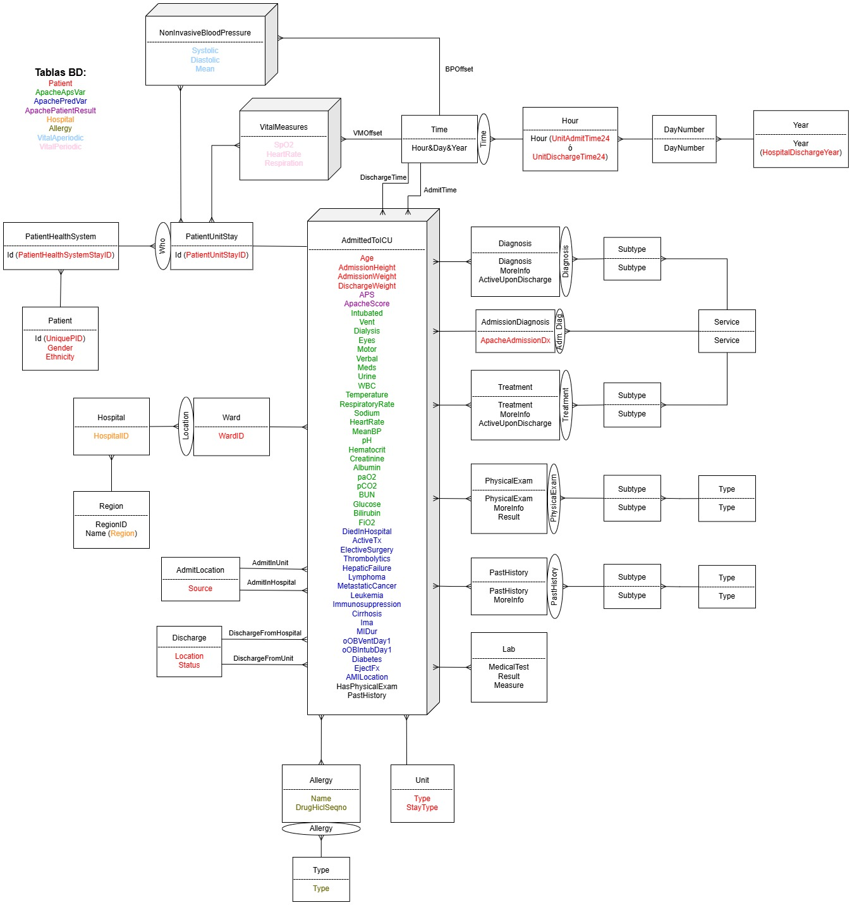

## Diseño conceptual

El diagrama conceptual muestra cómo se relacionan los hechos (cubos) con las dimensiones (tablas), sus jerarquías y el contenido de cada tabla. Los colores indican de qué tabla de la base de datos original procede cada valor.

**Cardinalidades.** Lo habitual es una relación 1:n entre dimensión y hecho, pero por cómo estaba construida la base de datos original, algunas dimensiones se relacionan con el hecho en m:n. Además, `AdmittedToICU` y `PatientUnitStay` están en 1:1, porque cada paciente tenía una única fila en las tablas que alimentan ese hecho.

**Dimensión Time.** Por privacidad, la base de datos no incluye día ni mes: solo la hora de ingreso y alta, el año del alta y el *offset* del alta (minutos desde el ingreso). Por eso `Time` almacena la hora, el número de días desde el ingreso y el año, calculados en el ETL.

**Jerarquías de `Diagnosis`, `Treatment`, `PhysicalExam` y `PastHistory`.** El tipo/servicio, el subtipo, el valor y la información adicional venían en una sola columna separada por `/` o `|`, y hubo que dividirlas en el ETL.

**Dimensión `Lab`.** Combina las tablas `Lab` y `CustomLab`.

**Jerarquía de `AdmissionDiagnosis`.** Para poder agrupar se necesitaba el nivel `Service`. La relación entre cada diagnóstico de ingreso y su servicio se obtuvo dando a Copilot los servicios de `Diagnosis` y los valores de `AdmissionDiagnosis`, revisando a mano que el resultado fuese correcto.